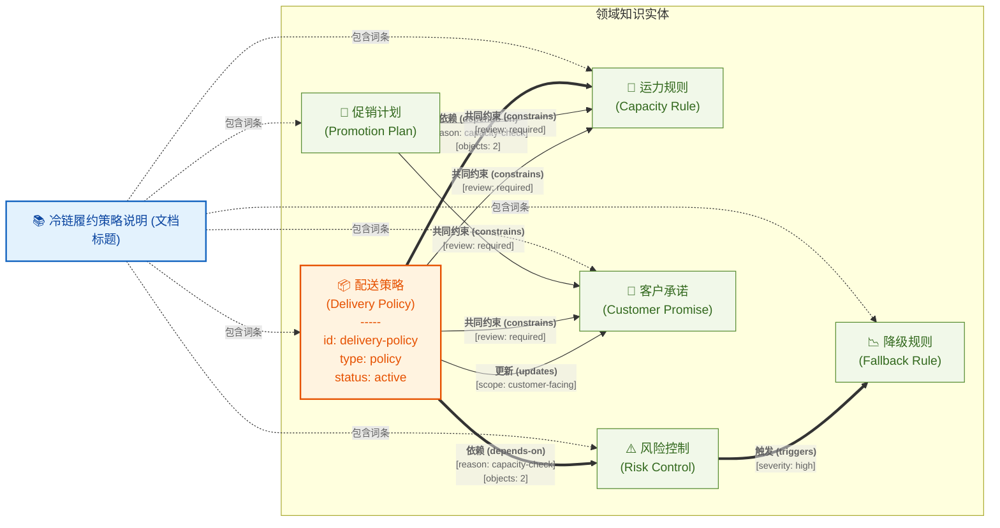

# 1

```asciidoc
= 冷链履约策略说明

[glossary]
配送策略:: 冷链订单在城市仓、前置仓和末端配送之间选择履约路径的规则集合。
运力规则:: 用于判断车辆、骑手、仓库波次和温控设备是否足够支持当前订单的规则。
风险控制:: 在履约过程中识别温控失败、延迟送达和异常签收风险的机制。
降级规则:: 当原计划履约路径无法满足约束时，用来选择替代履约路径的规则。
客户承诺:: 平台向客户展示并承诺的送达时间、温区和异常处理说明。
促销计划:: 运营团队为了提升转化或清理库存而安排的价格、曝光和补贴组合。

[#delivery-policy.policy, status=active]
== 配送策略

在日常履约中，rel:depends-on[依赖, objects=2, reason=capacity-check] indexterm2:[运力规则] 和 indexterm2:[风险控制]，因为冷链订单不只需要有货，还需要在承诺温区和承诺时间内完成拣货、交接与送达。

当运营团队准备扩大曝光时，indexterm2:[促销计划] 与 indexterm2:[配送策略] rel:constrains[共同约束, subjects=2, objects=2, review=required] indexterm2:[客户承诺] 和 indexterm2:[运力规则]，否则页面上的可售表达会早于真实供给能力。

如果系统监测到城市仓温控设备不足，indexterm2:[风险控制] 会在人工复核后 rel:triggers[触发, severity=high] indexterm2:[降级规则]，并由当前章节继续 rel:updates[更新, scope=customer-facing] indexterm2:[客户承诺]。
```

# 2

```asciidoc
= 冷链履约策略说明

[glossary]
配送策略:: 冷链订单在城市仓、前置仓和末端配送之间选择履约路径的规则集合。
运力规则:: 用于判断车辆、骑手、仓库波次和温控设备是否足够支持当前订单的规则。
风险控制:: 在履约过程中识别温控失败、延迟送达和异常签收风险的机制。
降级规则:: 当原计划履约路径无法满足约束时，用来选择替代履约路径的规则。
客户承诺:: 平台向客户展示并承诺的送达时间、温区和异常处理说明。
促销计划:: 运营团队为了提升转化或清理库存而安排的价格、曝光和补贴组合。

[#delivery-policy.policy, status=active]
== 配送策略

在日常履约中，rel:depends-on[依赖, objects=2, reason=capacity-check] 运力规则和风险控制，因为冷链订单不只需要有货，还需要在承诺温区和承诺时间内完成拣货、交接与送达。

当运营团队准备扩大曝光时，促销计划与配送策略 rel:constrains[共同约束, subjects=2, objects=2, review=required] 客户承诺和运力规则，否则页面上的可售表达会早于真实供给能力。

如果系统监测到城市仓温控设备不足，风险控制会在人工复核后 rel:triggers[触发, severity=high] 降级规则，并由当前章节继续 rel:updates[更新, scope=customer-facing] 客户承诺。
```


